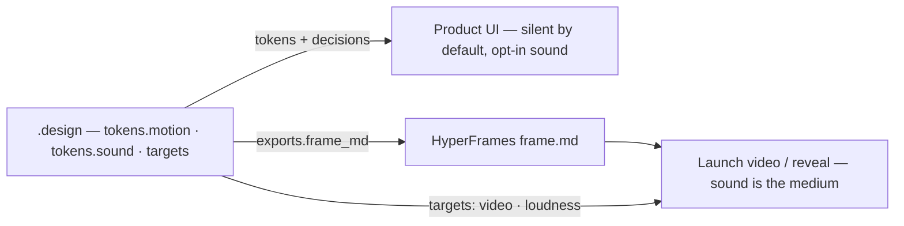

# Motion, sound, and video

How a `.design` contract carries timing and audio, and how it feeds a rendered video without becoming a video tool.

## The three surfaces



| Surface | Sound default | What the contract decides |
| --- | --- | --- |
| Product UI | **Silent.** `tokens.sound.enabled: false`, persisted toggle, never on hover / focus / keystroke | Which moments earn a sound (`decisions.sound`), the one material, levels, lengths, the sync tolerance |
| Marketing / editorial | Silent unless the pattern says otherwise | `patterns.<name>.treatment: editorial` may allow a first-run hero moment; still off by default |
| Video (`targets[].name: video`) | **Sound is the medium.** Every contact frame gets a transient; holds are silence | `aspect`, `fps`, delivery `loudness`; `tokens.motion` for pacing; `tokens.sound.material` for the family |

## Sound tokens in one screen

```yaml
tokens:
  sound:
    enabled: false
    material: "felt mallet on a small wooden block, dry, no tail"
    peak: -3dBFS
    loudness: { feedback: -16LUFS, notification: -12LUFS }
    duration: { tick: 60ms, send: 200ms, error: 150ms, notification: 400ms }
    sync-lag-max: 30ms
assets:
  sounds: { tick: ./public/sfx/tick.wav, send: ./public/sfx/send.wav }
decisions:
  sound:
    - if: "hover, focus, scroll, or keystroke"
      then: { sound: none }
    - if: "daily moment and the user's toggle is on"
      then: { sound: "{tokens.sound.duration.send}", trigger: "settle frame of the confirming animation" }
```

Rules that follow (SPEC §11.6): one material; contour carries meaning (rising = success, falling = dismiss or error); sound reinforces and never carries information alone; the transient lands on the contact frame and may lag it, never lead it.

## Generating the files

The contract names the family and the material; producing audio is procedure. Companion skills do it — ElevenLabs `sound-effects` when a key exists, the `design-engineering` sound generator (synth or open-weight model) when it does not — and every prompt starts with `tokens.sound.material`. Files land at the `assets.sounds` paths; the linter warns when a `duration` role has no file or a file has no role, and errors on `data:` URIs.

## Video: `frame.md`

```bash
python scripts/export_design.py .design --only frame_md --out-dir .
```

emits a HyperFrames `frame.md` — YAML frontmatter (`colors`, `typography`, `spacing`, `radii`, `components`, plus `motion` and `sound`) and a body with Overview, The Frame, Motion, Sound, Composition Rules (from `constraints` and `rationale.dos` / `donts`), and Known Gaps. HyperFrames reads `frame.md` first, so the video inherits the brand's timing and material while its beats, treatments, and layout stay with the frame author. Regenerate after token edits; never hand-edit values in the generated file.

## Verify

`scripts/lint_design.py` covers the sound rules; `scripts/diff_design.py` treats removed `tokens.sound.*` and `assets.sounds.*` entries as regressions like any other token. A review of generated UI checks: no sound before a user gesture, a persisted mute off by default, one material, transient on the settle — see [skills/design/references/REVIEW.md](../skills/design/references/REVIEW.md).

Normative detail: [SPEC.md §7.4–§7.6, §11.6, §15](../SPEC.md).
